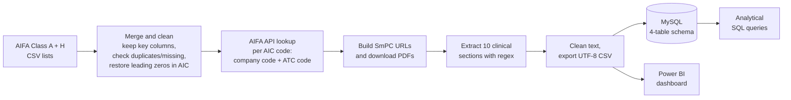
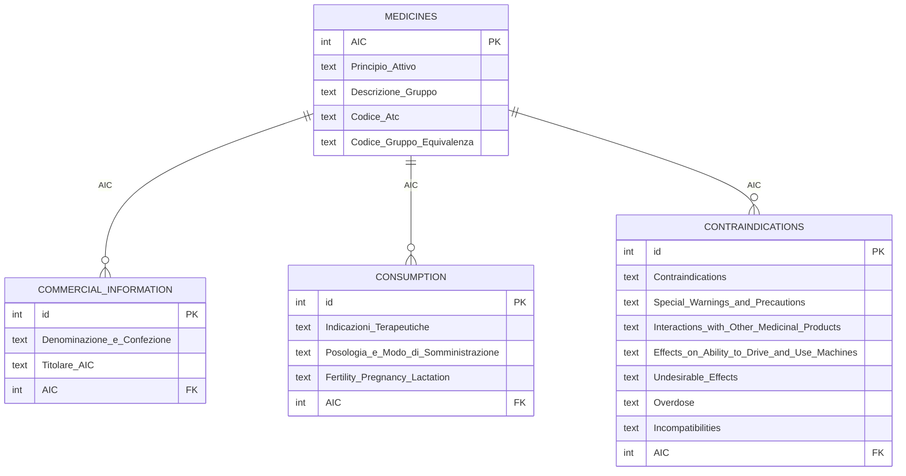

# Italian Medicines Database: from Official PDFs to SQL and Power BI

An end-to-end data pipeline that builds a structured, queryable database of medicines reimbursed in Italy. It combines the official **AIFA** (Italian Medicines Agency) lists with clinical information **scraped from thousands of product-information PDFs**, then models it in **MySQL** and visualises it in **Power BI**.


## Highlights

- **Automated data collection:** queried the official AIFA API for each medicine's identifiers, built download links and extracted text from each Summary of Product Characteristics (SmPC) PDF.
- **Robust section extraction** of 10 clinical fields (indications, dosage, contraindications, warnings, interactions, pregnancy, driving, side effects, overdose, incompatibilities) from inconsistently formatted PDFs.
- **Normalised relational schema** with four linked tables, plus analytical SQL queries.
- **Interactive Power BI dashboard** with word clouds, charts and search for exploring active ingredients, indications and side effects.

## Problem

Clinical information about Italian medicines is public but locked inside individual PDF leaflets. It can't be searched, compared or analysed at scale. This project turns those documents into structured data that analysts, pharmacists or downstream AI applications (such as a medicine question-answering assistant) can query.

## Data sources

- **[AIFA lists of Class A and Class H medicines](https://www.aifa.gov.it/en/liste-farmaci-a-h)** (by active ingredient, October 2024 edition): over 10,000 Class A and over 2,000 Class H products.
- **AIFA public API and SmPC documents:** used to look up each product's ATC code and company code, and to download its official product information PDF.

The source CSVs and generated datasets are not included. The notebook rebuilds them from the official sources.

## Pipeline



**Extracting sections from messy PDFs**
Section headings in SmPC PDFs vary in spacing, casing and layout. Each section (e.g. *4.3 Contraindications*) is located with a regular expression that requires:
- the section number at the start of a line, and
- the expected first letter of the heading,
- while ignoring case and extra whitespace.

The text between consecutive headings is extracted and cleaned of symbols and line breaks. Fields that can't be found reliably are marked `not available` instead of filled with wrong text, and broken or missing PDFs are handled the same way.

## Database design



**Example analyses** (see [`sql/schema_and_analysis.sql`](sql/schema_and_analysis.sql)):
- Medicines grouped by therapeutic equivalence group and by ATC classification
- Number of distinct active ingredients and products per manufacturer
- Number of dosage forms per active ingredient
- Approximate number of listed side effects per active ingredient

## Engineering challenges solved

| Challenge | Solution |
|---|---|
| Excel removed the leading zeros of 9-digit AIC codes, breaking API lookups | Restored them with zero-padding and kept codes as strings |
| PDF URLs need a company code that isn't in the AIFA lists | Retrieved it per product from the AIFA API, then built the URLs |
| Inconsistent section headings across PDFs | Rule-based regex (line position + number + first letter), case- and whitespace-insensitive |
| Unreadable symbols and icons in extracted text | Unicode normalisation and character filtering |
| Very long sections exceeded Excel's cell limit | Length cap, with oversized fields flagged as unavailable |
| Semicolon-separated files broke the MySQL import | Re-exported as UTF-8, comma-separated, fully quoted CSV |
| Uninformative words in the Power BI word clouds | Custom stop-word list |

## Repository structure

```
aifa-medicines-data-pipeline/
├── notebooks/
│   └── aifa_dataset_builder.ipynb      # merge, API lookup, PDF download and section extraction
├── sql/
│   └── schema_and_analysis.sql         # MySQL schema, data loading and analytical queries
├── dashboard/
│   └── aifa_medicines_dashboard.pbix   # Power BI dashboard (open with Power BI Desktop)
├── docs/
│   └── report_summary.md               # summary of the project report
└── requirements.txt
```

## How to run

1. Download the Class A and Class H lists (by active ingredient) from the [AIFA website](https://www.aifa.gov.it/en/liste-farmaci-a-h).
2. `pip install -r requirements.txt`
3. Run `notebooks/aifa_dataset_builder.ipynb`. It was written for Google Colab and reads the CSVs from `/content/`, so update the file names and paths to match your download.
4. Import `Final_Dataset.csv` into MySQL as a table named `final_dataset`, then run `sql/schema_and_analysis.sql`.
5. Open the dashboard in Power BI Desktop and point the data source to your `Final_Dataset.csv`.

The scraper sends one request per medicine to the public AIFA API, so a full run takes a while. Please use it responsibly.

## Project context

Project for the *Fundamentals of Programming and Data Management (Mod. B)* course, MSc Data Science, University of Naples Federico II (June 2025). A summary of the project report is in [`docs/report_summary.md`](docs/report_summary.md).
